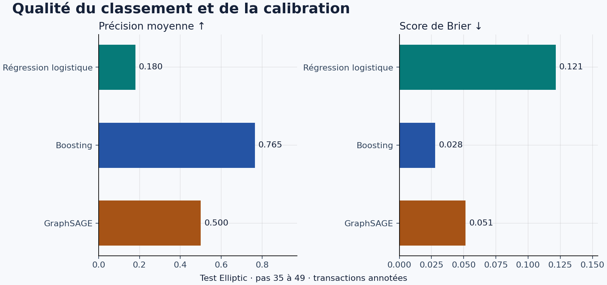
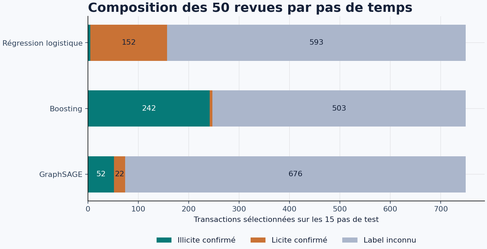
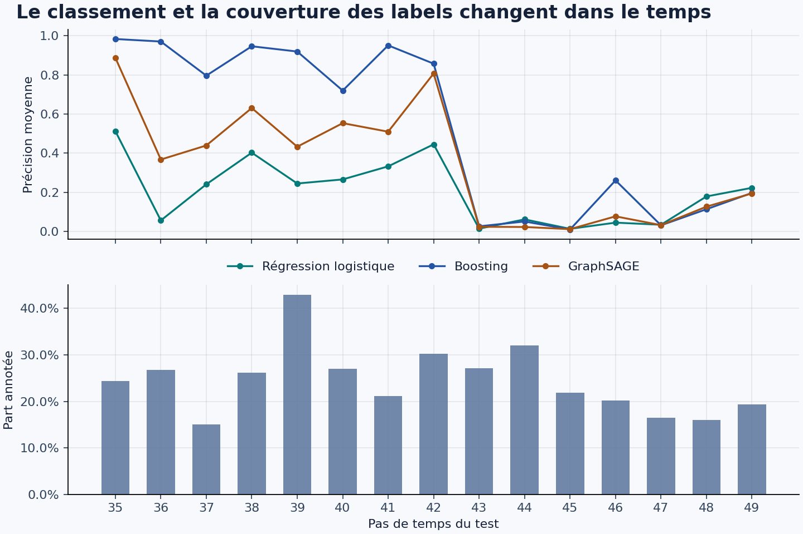

# Temporal Transaction Risk Benchmark

Sur Elliptic, le boosting retrouve **242 transactions illicites confirmées sur 750 dossiers examinés** à budget égal. GraphSAGE en retrouve 52 et la régression logistique 5. Le boosting sélectionne aussi 503 transactions sans label, ce qui laisse une large incertitude sur la précision réelle.

## Résultats sur les pas 35 à 49

| Modèle | Précision moyenne (AP) | Brier | Illicites confirmées | Licites confirmées | Labels inconnus | Plage de précision@50 |
| --- | ---: | ---: | ---: | ---: | ---: | ---: |
| Régression logistique | 0,180 | 0,121 | 5 | 152 | 593 | 0,7–79,7 % |
| Boosting d’histogrammes | 0,765 | 0,028 | 242 | 5 | 503 | 32,3–99,3 % |
| GraphSAGE dirigé | 0,500 | 0,051 | 52 | 22 | 676 | 6,9–97,1 % |

AP et Brier portent sur les **16 670 transactions annotées sur 67 504**. Le classement utilise les scores bruts. Le Brier utilise les probabilités calibrées sur les annotations de validation. Les bornes de précision@50 traitent les transactions inconnues comme toutes licites puis comme toutes illicites. Elles expriment les valeurs compatibles avec les annotations disponibles.







## Protocole

- **Chronologie.** Les pas 1–29 servent à entraîner les modèles, les pas 30–34 à fixer le budget et à calibrer les probabilités, et les pas 35–49 au test. Les deux classes connues participent aux pertes supervisées. Les transactions inconnues restent dans le graphe et dans les listes de revue.
- **Variables.** Les modèles utilisent 93 attributs locaux. L’identifiant, le pas de temps et les 72 statistiques de voisinage fournies par Elliptic sont exclus des entrées. La standardisation pour la régression et le graphe est ajustée sur les exemples annotés d’entraînement. Les valeurs standardisées sont bornées à ±12.
- **Graphe.** PyTorch Geometric calcule une moyenne des voisins entrants à un saut. Le filtre écarte toute arête dont la source vient après la cible. Dans cette version, les 234 355 arêtes relient des transactions d’un même pas, avec 140 223 arêtes dans le préfixe d’entraînement. Le scénario suppose l’accès aux transactions du lot en fin de pas. Le code vérifie que l’ajout des pas ultérieurs conserve les scores du préfixe d’entraînement.
- **Budget.** Parmi 25, 50, 100 et 200 revues par pas, la régression logistique devait atteindre 10 % de précision confirmée en validation. Aucune option n’a atteint ce seuil. La règle de repli a retenu 50 revues, qui donnent la meilleure borne basse (2 % en validation). Ce budget commun est figé au test. Les ex æquo suivent l’ordre d’entrée.
- **Dérive.** L’AP du boosting passe de 0,858 au pas 42 à 0,026 au pas 43. La proportion annotée varie selon le pas. Les scores sur les labels disponibles peuvent donc refléter un changement de couverture en plus d’un changement de comportement.

Les [mesures agrégées](reports/metrics.json) contiennent les comptes, les bornes par pas et les huit principaux coefficients standardisés de la régression. Leur rang décrit le modèle ajusté. Les attributs anonymisés et corrélés limitent leur interprétation. Les scores et la calibration reflètent le sous-ensemble annoté, avec des labels inconnus probablement non aléatoires. Les dates d’attribution des labels et l’ordre précis dans chaque lot sont indisponibles. Les conclusions se limitent au triage rétrospectif à la clôture de ces lots.

## Reproduire sur CPU

Python 3.13, PyTorch 2.9.1 CPU et PyTorch Geometric 2.7.0. Prévoir environ 700 Mo pour les trois CSV extraits, en plus du cache de téléchargement et de l’environnement Python.

```powershell
python -m venv .venv
.\.venv\Scripts\Activate.ps1
python -m pip install torch==2.9.1 --index-url https://download.pytorch.org/whl/cpu
python -m pip install -r requirements.txt
python fetch_elliptic.py
python -m unittest discover -s tests -v
python benchmark.py
python plot_results.py --metrics runs/benchmark/metrics.json --output runs/figures
```

Sous macOS et Linux, activer avec `source .venv/bin/activate`. Le [manifeste](data/manifest.json) fixe la version Kaggle et les empreintes des entrées. Deux exécutions sur Windows CPU ont donné le même SHA-256 `1de7db55d6c5cffa31fea949587e5f67b82cf1e0b33dc21dd334b2d9c4dfdffe`. La CI exécute les tests de protocole et régénère les figures depuis le rapport agrégé.

## Sources et droits

Elliptic publie les données sous **CC BY-NC-ND 4.0**, selon la fiche Kaggle. Le dépôt contient le code MIT, les empreintes et les statistiques agrégées. Les CSV, identifiants, prédictions individuelles et paramètres appris restent locaux. [Elliptic Data Set](https://www.kaggle.com/datasets/ellipticco/elliptic-data-set) · [Weber et al., 2019](https://arxiv.org/abs/1908.02591) · [Licence du jeu de données](https://creativecommons.org/licenses/by-nc-nd/4.0/)
